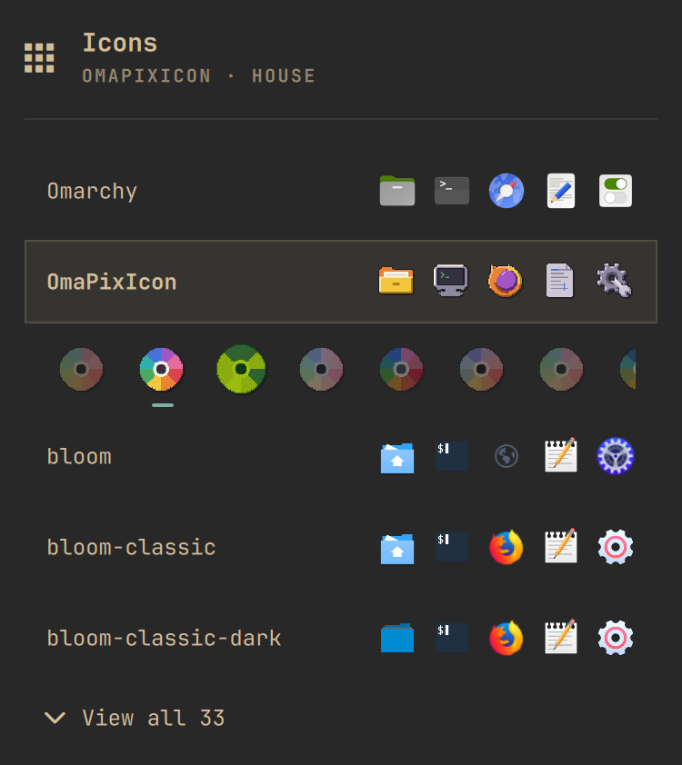

# OmaIcon

An icon pack switcher for the [Omarchy](https://omarchy.org) bar. Pick any installed icon pack in one panel: apps, the dock and the launcher switch together, and the choice survives Omarchy theme switches. OmaIcon ships [**OmaPixIcon**](https://github.com/Raiden-MeixElysia/OmaPixIcon), a pixel-art pack recoloured to your Omarchy theme.

<p align="center"></p>

## Install

Omarchy installs plugins straight from their git repo, so this works with or without the marketplace listing:

```bash
omarchy plugin add https://github.com/Raiden-MeixElysia/OmaIcon --enable
```

It asks you to confirm and where in the bar to put the icon, clones the repo into `~/.config/omarchy/plugins/raiden-meixelysia.omaicon`, and enables it. Click the grid icon. Nothing changes until you pick a pack.

Update to the latest version:

```bash
omarchy plugin update raiden-meixelysia.omaicon
```

Needs Omarchy 4 (Quattro). Python 3 and `gsettings` ship with Omarchy; there are no other dependencies.

## Use

- The panel shows five packs; **View all** shows the rest. Click one to switch.
- **Omarchy** follows the pack each Omarchy theme names in its `icons.theme`.
- Hover OmaPixIcon, or move to it with the arrow keys, and its palettes slide out. Click one, or press ←/→ and Enter.
- The button at the end of those palettes fetches the newest OmaPixIcon icons without waiting for a plugin update. Its tooltip shows the date of the icons you have.

From a terminal:

```bash
E=~/.config/omarchy/plugins/raiden-meixelysia.omaicon/engine/omaicon.py
python3 -B $E use Papirus
python3 -B $E palette nord
python3 -B $E use omarchy
python3 -B $E update-pack
```

## What it changes

Only after you pick a pack:

- `org.gnome.desktop.interface icon-theme`, the setting GTK and Qt apps read.
- `~/.local/share/icons/OmaPixIcon/`, once you pick OmaPixIcon.
- `~/.icons/omaicon-shell-*/`: the chosen pack as the dock and launcher see it. They read icons by file name from every icon folder, not from the selected theme, so OmaIcon puts the chosen pack's files first.
- `~/.config/omarchy/hooks/theme-set.d/50-omaicon`, which applies the choice again after an Omarchy theme switch.
- `~/.config/omaicon/config` and `~/.cache/omaicon/`.
- `~/.local/share/omaicon/pack/`, once you press the OmaPixIcon update button.
- Launchers in `~/.local/share/applications/`, only if you set `DESKTOP_FIX=1` in `~/.config/omaicon/config` (the OmaPixIcon installer does) and use OmaPixIcon. A few apps hard-code an icon file path in their launcher, which no icon pack can change, so OmaIcon rewrites that one `Icon=` line to the pack's icon name. It does so again when an app update rewrites its launcher. Originals are kept in `~/.local/state/omapix/desktop-backup/`, and `remove` puts them back.

OmaIcon goes online only when you press that button. It asks the GitHub API for the latest OmaPixIcon commit that changed `data/`, downloads `data/icons.json` and `data/omarchy-themes.json` at that commit from `raw.githubusercontent.com`, checks every icon and palette, and keeps them only if they pass. It downloads data, never code.

## Remove

```bash
python3 -B ~/.config/omarchy/plugins/raiden-meixelysia.omaicon/engine/omaicon.py remove
omarchy plugin remove raiden-meixelysia.omaicon
```

The first line deletes everything listed above and sets Omarchy's icons back. If you installed OmaPixIcon with its `install.sh`, uninstall with that instead; it also restores the launchers it re-pointed.

## Icon pack standard

The panel lists any icon pack that follows the same rules as Omarchy's default, Yaru:

- It is a [freedesktop icon theme](https://specifications.freedesktop.org/icon-theme-spec/latest/) in `~/.local/share/icons/<Name>/` or `/usr/share/icons/<Name>/`.
- Its `index.theme` has an `[Icon Theme]` section with `Name`, `Directories` and `Inherits`, and no `Hidden=true`.
- It inherits a Yaru variant, then `Adwaita` and `hicolor`, so an app it does not draw keeps the Omarchy icon. OmaPixIcon inherits whatever Yaru variant the current theme uses.
- It names icons by freedesktop names (`folder`, `utilities-terminal`, `web-browser`) and by each app's `Icon=` name or desktop id (`firefox`, `org.gnome.Nautilus`).
- To make a pack the icons of an Omarchy theme, put its folder name in that theme's `icons.theme`, one line, as the stock themes do (`Yaru-blue`). The **Omarchy** row follows that file.

## The built-in pack

`pack/` is a copy of the OmaPixIcon renderer and icon data. `pack/SOURCE` names the last OmaPixIcon commit that changed the data, and its date. The update button keeps whichever is newer, this copy or the one it fetched. Icons are drawn and requested in [OmaPixIcon](https://github.com/Raiden-MeixElysia/OmaPixIcon); to ship a new release of the pack:

```bash
tools/sync-pack.sh ../OmaPixIcon
```

## License

[MIT](LICENSE), for the plugin and the bundled pack ([`pack/LICENSE`](pack/LICENSE)).
